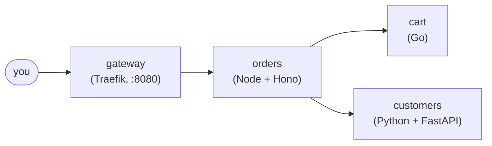
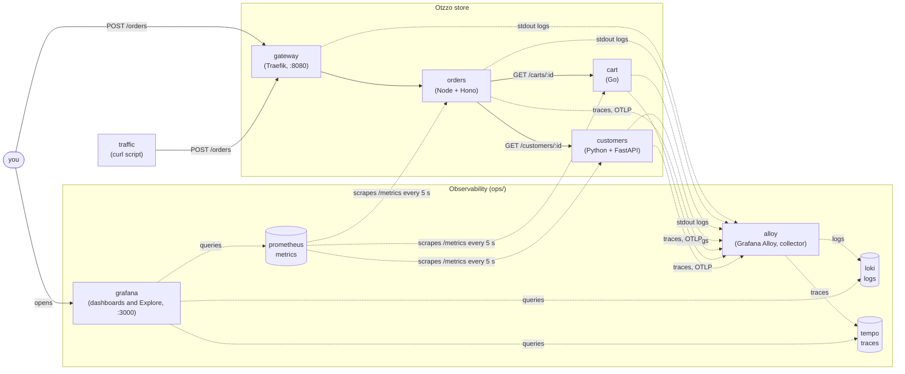

# Otzzo system

Hands-on homework for the observability session of *Architecture in Practice*.


## C4 Lvl 2 Diagram of services only:



### Project services

| Folder | Technology | Goal |
| --- | --- | --- |
| `projects/orders/` | Node + Hono, `POST /orders` | Process orders from users |
| `projects/cart/` | Go, `GET /carts/:id` | Store and mantain shopping cart info |
| `projects/customers/` | Python + FastAPI, `GET /customers/:id` | Manage customer information |

## OPS Observability services

| Folder | Technology | Goal |
| --- | --- | --- |
| `ops/gateway/` | Traefik | the only public entry point |
| `ops/alloy/` | Grafana Alloy | collects container logs, receives traces (OTLP) |
| `ops/loki/`, `ops/tempo/`, `ops/prometheus/` | storage for logs, traces and metrics |
| `ops/grafana/` | dashboards and Explore |
| `ops/traffic/` | a script that plays the customers of the shop and sends orders |
| `scripts/` | the check scripts |

### How the pieces are wired

- **Metrics.** Each service exposes `/metrics`. Prometheus scrapes them every 5 seconds.
- **Logs.** Each service writes JSON lines to stdout with `ts`, `level`, `service`, `msg`, `trace_id` and ids such as `order_id`, `cart_id`, `customer_id`. Alloy ships them to Loki with one label, `service`.
- **Traces.** Each service has the OpenTelemetry SDK and sends spans to Alloy, which forwards them to Tempo. Alloy receives OTLP at `alloy:4318` (HTTP) and `alloy:4317` (gRPC).
- **The key rule.** A service never starts a trace of its own. If a request arrives with a W3C `traceparent` header, the service joins that trace, logs its `trace_id` and passes the header on. If it arrives without one, there is no span and the log says `"trace_id":"-"`. Trace ids are created in one place only: the gateway, as in the slides.
- When a request has a trace id, `orders` returns it in the `x-trace-id` response header.

## Full C4 Diagram

Solid arrows are the requests of the shop. Dotted arrows are telemetry and the queries that read it.



## Start

You need Docker Desktop (about 1 GB of free RAM for the stack) and nothing else.

```
docker compose up --build
```

The first start downloads and builds images, so it takes a few minutes. It is ready when `gateway` is running. Then open Grafana at <http://localhost:3000> (no login).

To stop and delete everything: `docker compose down`.

## The failing call

macOS, Linux, Git Bash:

```bash
curl -i -X POST http://localhost:8080/orders \
  -H 'Content-Type: application/json' \
  -d '{"customerId":"c-1002","cartId":"cart-7"}'
```

Windows PowerShell:

```powershell
curl.exe -i -X POST http://localhost:8080/orders -H "Content-Type: application/json" -d '{\"customerId\":\"c-1002\",\"cartId\":\"cart-7\"}'
```

## Hints for the tools

**Logs (Grafana > Explore > Loki).** Switch the query editor to *Code* and try:

```logql
{service="orders"}
{service=~".+"} | json
{service=~".+"} | json | level="error"
{service=~".+"} | json | trace_id="PASTE-A-TRACE-ID"
```

`trace_id` is a field inside the log line, not a label, so it needs `| json` before the filter. Look at what the lines say today, before you change anything. Do not trust the log level alone: follow one request.

**Traces (Grafana > Explore > Tempo).** Paste a trace id in the *TraceQL* box to see the waterfall. A log line with a real trace id also has a link that opens its trace, and a trace has a *Related logs* button that goes back to the logs.

**Dashboard (Grafana > Dashboards > Otzzo - Orders).** Request rate, error rate and duration per service, a counter of rejected orders, and the latest logs.

**Gateway.** Traefik reads `ops/gateway/traefik.yml` once, at startup. Its documentation has a page on tracing. After changing the file:

```
docker compose restart gateway
```

**Rebuilding one service after a code change:**

```
docker compose up --build -d <service>
```

## How to activate the trace ids:

On the traefik.yml add:

```yaml
tracing:
  serviceName: gateway
  otlp:
    http:
      endpoint: http://alloy:4318/v1/traces
```
