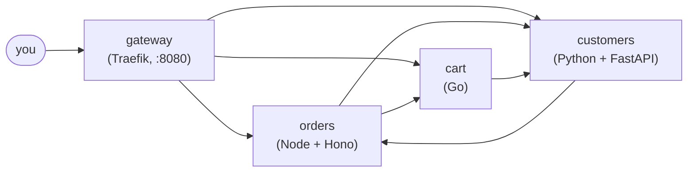
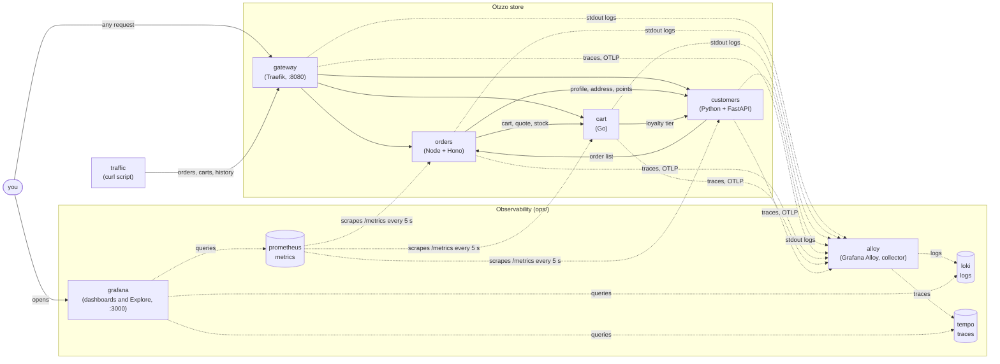

# Otzzo system

Hands-on homework for the observability session of *Architecture in Practice*.


## C4 Lvl 2 Diagram of services only:



### Project services

| Folder | Technology | Goal |
| --- | --- | --- |
| `projects/orders/` | Node + Hono | Checkout, order lookup, order list, cancellation |
| `projects/cart/` | Go | Shopping carts, price quotes (subtotal, loyalty discount, shipping) and stock |
| `projects/customers/` | Python + FastAPI | Profiles, shipping addresses, loyalty tiers and points, order history |

### Public API (through the gateway, port 8080)

| Request | Service | What it does | Calls |
| --- | --- | --- | --- |
| `POST /orders` | orders | checkout of a cart; `recipientId` is optional and makes it a gift | customers, cart |
| `GET /orders/:id` | orders | one order | |
| `GET /orders?customerId=` | orders | the orders of a customer | |
| `POST /orders/:id/cancel` | orders | cancels: gives stock and loyalty points back | cart, customers |
| `GET /carts/:id?customerId=` | cart | the cart | |
| `PUT /carts/:id/items/:sku` | cart | sets the quantity of an item | |
| `GET /carts/:id/quote?customerId=&country=` | cart | price of the cart | customers |
| `POST /stock/reservations`, `DELETE /stock/reservations/:orderId` | cart | keeps or releases stock for an order | |
| `GET /stock/:sku` | cart | stock level of a product | |
| `GET /customers/:id` | customers | profile | |
| `GET /customers/:id/shipping-address` | customers | shipping address, validated | |
| `GET /customers/:id/loyalty` | customers | loyalty tier, discount, points | |
| `POST /customers/:id/loyalty/points` | customers | adds or takes back points | |
| `GET /customers/:id/orders` | customers | order history | orders |

Customers `c-1001` to `c-1005` exist, each with one cart: `cart-7`, `cart-9`, `cart-3`, `cart-12`, `cart-5`.

## OPS Observability services

| Folder | Technology | Goal |
| --- | --- | --- |
| `ops/gateway/` | Traefik | the only public entry point; creates the trace id of each request |
| `ops/alloy/` | Grafana Alloy | collects container logs, receives traces (OTLP) |
| `ops/loki/`, `ops/tempo/`, `ops/prometheus/` | storage for logs, traces and metrics |
| `ops/grafana/` | dashboards and Explore |
| `ops/traffic/` | a script that plays the customers of the shop: browsing, orders, gifts, cancellations |

### How the pieces are wired

- **Metrics.** Each service exposes `/metrics`. Prometheus scrapes them every 5 seconds.
- **Logs.** Each service writes JSON lines to stdout with `ts`, `level`, `service`, `msg`, `trace_id` and ids such as `order_id`, `cart_id`, `customer_id`. Alloy ships them to Loki with one label, `service`.
- **Traces.** Each service has the OpenTelemetry SDK and sends spans to Alloy, which forwards them to Tempo. Alloy receives OTLP at `alloy:4318` (HTTP) and `alloy:4317` (gRPC).
- **What the services log.** Every service follows the same rule: one line when a request comes in, one line before it asks anything to a store or to another service, one line per step of the flow, and one line with what it answers. The lines carry the real values (ids, amounts, timeouts, query strings), so a request can be followed from the logs alone.
- **The key rule.** A service never starts a trace of its own. If a request arrives with a W3C `traceparent` header, the service joins that trace, logs its `trace_id` and passes the header on. If it arrives without one, there is no span and the log says `"trace_id":"-"`. Trace ids are created in one place only: the gateway, as in the slides.
- When a request has a trace id, the service that answers it returns the id in the `x-trace-id` response header.

## Full C4 Diagram

Solid arrows are the requests of the shop. Dotted arrows are telemetry and the queries that read it.



## Start

You need Docker Desktop (about 1 GB of free RAM for the stack) and nothing else.

```
docker compose up --build
```

The first start downloads and builds images, so it takes a few minutes. It is ready when `gateway` is running. Then open Grafana at <http://localhost:3000> (no login).

To stop and delete everything: `docker compose down`.

## The homework

Five incidents are open in [`incidents/`](incidents/). For each one:

1. Reproduce it with the request in the ticket and copy the `x-trace-id` of the response.
2. Follow that trace through the services, in the logs and in the waterfall.
3. Find the step where a value, a name or a duration stops being right, and which service is responsible.
4. Write a ticket for the owners of that service with [`incidents/TICKET-TEMPLATE.md`](incidents/TICKET-TEMPLATE.md): what happens, the log lines that prove it, and the fix you suggest.

You work as the on-call engineer: you have the logs and the traces, not the code of the services. Do not open `projects/`.

Some incidents log an error and some do not. Sometimes the service that logs the error is not the one at fault.

## Hints for the tools

**Logs (Grafana > Explore > Loki).** Switch the query editor to *Code* and try:

```logql
{service="orders"}
{service=~".+"} | json
{service=~".+"} | json | level="error"
{service=~".+"} | json | trace_id="PASTE-A-TRACE-ID"
```

`trace_id` is a field inside the log line, not a label, so it needs `| json` before the filter. Look at what the lines say today, before you change anything. Do not trust the log level alone: follow one request.

**Traces (Grafana > Explore > Tempo).** Paste a trace id in the *TraceQL* box to see the waterfall. A log line with a real trace id also has a link that opens its trace, and a trace has a *Related logs* button that goes back to the logs.

**Dashboard (Grafana > Dashboards > Otzzo - Store).** Request rate, error rate and duration per service, a counter of rejected orders, and the latest logs.

To read one request as a story, sort the result oldest first (*Options > Order > Oldest first*) and show only the fields you need:

```logql
{service=~"orders|cart|customers"} | json | trace_id="PASTE-A-TRACE-ID" | line_format "{{.service}}  {{.level}}  {{.msg}}"
```

**Traffic.** The `traffic` container plays the customers all the time, so your request is one among many. See what it sends, with the trace id of each request:

```
docker compose logs -f traffic
```

**Gateway.** Traefik creates the trace id of every request (`tracing` in `ops/gateway/traefik.yml`) and the services join that trace.
